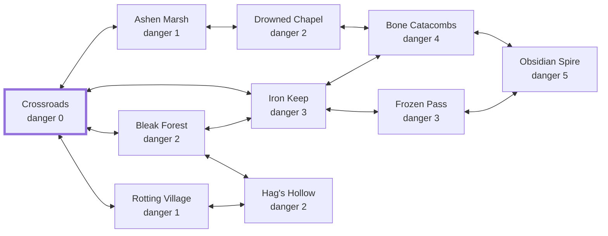

# grimhold

## Description

A text-based dungeon crawler that runs in your terminal. You explore cursed regions, stumble into random encounters, fight foes in dice-based combat, and record your kills in a bestiary. 

## World map

Generated from `data/world.json`. `<-->` is a two-way exit, `-->` a one-way exit (start region in bold).

