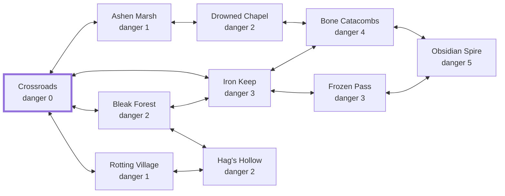

# grimhold

## Description

A text-based dungeon crawler that runs in your terminal. You explore cursed regions, stumble into random encounters, fight foes in dice-based combat, and record your kills in a bestiary. 

### Build
```bash
go build -o grimhold cmd/grimhold/main.go
```

### Run
```bash
./grimhold
```
or
```bash
go run ./cmd/grimhold
```

## Map
Generated from `data/world.json`. `<-->` is a two-way exit, `-->` a one-way exit (start region in bold).



---

## Sample Session

```text
----- Welcome to Grimhold! -----
a text-based dungeon crawler that runs in your terminal
Type 'help' to see available commands, or 'look' to check surroundings.

grimhold > help

Grimhold — Commands:
  bestiary  Browse monsters in the bestiary (interactive sub-repl)
  character Display your character sheet
  exit      Exit the program
  explore   Wander the region (risk an encounter)
  help (h)  Show available commands
  inspect   View monster stat block (usage: inspect <monster>)
  load      Load the game state from save.json
  look      Describe your surroundings and exits
  map       List all known regions and connections
  rest      Rest to restore HP (once per region visit)
  save      Save the game state to save.json
  travel    Travel to a connected region (usage: travel <region>)

grimhold > look

Crossroads [crossroads]
A gallows tree leans over four rutted roads. Crows watch you choose which one to die on.
Danger: 0 (Peaceful)
Exits:  ashen-marsh, bleak-forest, iron-keep, rotting-village

grimhold > character
      /\
     (o.o)
   <--|#|---==>
     / \
    _] [_
=== Character Sheet ===
Level: 1
XP: 0 / 50
Gold: 0 gp
Health: [████████████] 20/20 HP
Attack Bonus: +4
Weapon: Longsword (1d8+2)

grimhold > travel ashen-marsh

✈ Travelling to Ashen Marsh...

Ashen Marsh [ashen-marsh]
Fog, iron, and things that breathe under the water.
Danger: 1 (Unsettling)
Exits:  crossroads, drowned-chapel

grimhold > explore

⚔ Goblin emerges from the gloom! (AC 15, HP 7)
   You: [████████████] 20/20 HP | Attack: +4 | Weapon: Longsword (1d8+2)

── Round 1 ── (type attack or flee)
grimhold (fight) > attack
You attack:    d20 (14) +4 = 18 vs AC 15 → HIT
Damage:        Goblin takes 7 damage (HP 0)

★ Goblin is slain! You win!
You gained 35 XP!
You scavenged 14 gold from the corpse.

grimhold > rest
You are already at full health.

grimhold > save
✔ Game saved successfully to save/save.json.

grimhold > inspect goblin

⚔ Goblin
   Small humanoid
   Armor Class:      15
   Hit Points:       7
   Challenge Rating: 1/4
   ─────────────────────────────
   STR:  8  DEX: 14  CON: 10
   INT: 10  WIS:  8  CHA:  8
   ─────────────────────────────
   Action: Scimitar (+4 to hit, 1d6+2 dmg)

grimhold > bestiary

Consulting the bestiary archives...

=== Bestiary of Foes ===
 [UNSLAIN] Aboleth (CR 10, aberration, 135 HP, 17 AC)
 [UNSLAIN] Acolyte (CR 1/4, humanoid, 9 HP, 10 AC)
 [SLAIN]   Goblin (CR 1/4, humanoid, 7 HP, 15 AC)

[ prev | next | back ]

grimhold (bestiary) > back
Returning to Grimhold.

grimhold > exit
Thanks for playing.
```